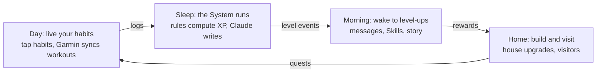
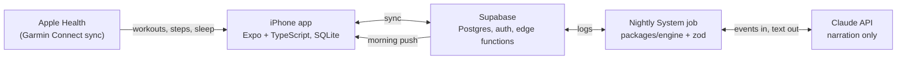

# The Wandering Inn: Habit Game Design Doc

Nov 21, 2026 · @Kyle

## Pitch and pillars

**Working title: Inn of Small Steps.** You are the newest Earthers in Liscor, and your real habits are your characters' lives there. The System only levels you when you sleep. Every morning you wake to level-up messages earned by yesterday's choices: \[Rider Level 7!\], \[Skill – Hearty Cooking obtained!\].

**What we take from Prado Traveler:** real-world input powers a slow RPG; progress happens in the background; classes, crafting and friends give it depth. **What changes:** Prado tracks one input (steps). Here many habits feed the game: you pick a class path, and what you actually do shapes your Skills and evolutions.

**Audience:** a standalone game built for two players first, Kyle and his wife, with room to open it to friends later. That means accounts and a second player exist from the first playable build, not as a late add-on.

**Scope:** this design covers Levels 1 to 10, roughly the first two months. Anything past Level 10 is parked under Later and gets designed when you get close.

### Design pillars

1. **You choose the direction; habits shape the details.** You pick a class path. What you actually do, chores included, decides your Skills and which evolutions are offered.
2. **Levels come at night.** Habits are logged during the day. All XP, levels and Skills resolve in one nightly "sleep" event, which makes waking up the reward moment.
3. **Levels are never lost.** Missing a day costs XP you didn't earn, never XP you had. No streak that shatters.
4. **Slow is the point.** Level 10, about 7 weeks in, is the first big milestone. Matches canon pacing and keeps the game from front-loading.
5. **Your Liscor house is the meta-game.** Habits produce resources; resources fix up the house; a better house draws visitors; visitors bring quests that are new habits.
6. **Claude is the System, not the scorekeeper.** Rules compute the numbers. Claude names Skills, writes the messages and tells the story.

## Core loop

One loop runs every real day, and the sleep step is the only place progress is computed.



During the day you only log. At night the System turns logs into levels. In the morning you read what you became, then spend rewards on your house in Liscor, where visitors hand you tomorrow's quests.

## Day one

Setup takes about 10 minutes each, and the game is playable that same evening.

1. **Arrive.** A short pre-written scene: you come through to Liscor as new Earthers and find the rented house.
2. **Pick a path.** Short descriptions of the 9 base paths. You can switch freely during the first 7 days.
3. **Name your rooms.** List your real rooms; each gets a matching room in the Liscor house.
4. **Bring in the chore list.** Add chores, or import from wherever the list lives now.
5. **Choose starting habits.** Up to 5 active habits each at first, with goals (PT marked prescribed at 3x a week). More slots open after week 2 (8 in all for now), so day one isn't overwhelming.
6. **Connect Apple Health.** Turn on Garmin Connect's Apple Health sync, then allow workouts, steps and sleep.
7. **Invite your partner.** The second player joins the same house by invite link and does steps 2, 5 and 6.
8. **First outing.** A guided Tier 1 errand that teaches stamina and choices.
9. **Sleep.** The first night grants your class: \[Rider Level 1!\].

## Classes and Skills

You choose the direction; your habits shape the details. Each player picks a class path on day one and gets it on the first night (\[Rider Level 1!\]). Every habit feeds your class, and what you actually do decides which Skills you get and which evolutions are offered.

### Class paths

| Path | Focus domains (full XP) | What evolutions might look like |
| --- | --- | --- |
| \[Warrior\] | Strength, Recovery | \[Iron-Backed Warrior\], \[Mended Blade\], \[Shieldwall of Liscor\] |
| \[Rider\] | Endurance | \[Dawn Rider\], \[Floodplains Rider\], \[Rider of the Long Road\] |
| \[Housekeeper\] | Home | \[Hearth Warden\], \[Spotless Steward\], \[Keeper of Small Rooms\] |
| \[Chef\] | Nourish | \[Hearth Chef\], \[Field Chef\], \[Chef of Second Helpings\] |
| \[Monk\] | Recovery, Spirit | \[Patient Monk\], \[Monk of the Slow Mend\] |
| \[Mage\] | Mind | \[Hedge Mage\], \[Mage of Dusty Shelves\] |
| \[Artisan\] | Craft | \[Tinkering Artisan\], \[Artisan of Small Fixes\] |
| \[Bard\] | Craft, Bonds | \[Tavern Bard\], \[Bard of Shared Tables\] |
| \[Druid\] | Spirit, Rest | \[Garden Druid\], \[Druid of Quiet Mornings\] |

- **Nothing is wasted:** habits in your path's focus domains give full XP; every other habit gives half. Chores, rides, lifts and PT all level you.
- **One class for now:** each of you has one class through Level 10. A second path is a later decision.
- **Small starting list:** about 9 base paths in the MVP. Everything after that is evolved, not picked from a list.

### Evolutions get stranger as you level

As in canon (\[Magical Innkeeper\], \[Cryomancer\]), classes get more specific and personal the higher you go. The examples above are illustrations; real evolutions are generated for each player at each capstone.

- **Level 10:** base class plus one qualifier drawn from your strongest domain or habit pattern (\[Dawn Rider\] if you ride early).
- **How it's built:** the rules pick 3 options, each tied to a real domain or event from your history, and set the mechanics (the evolved class keeps its focus domains and adds your top recent one). Claude writes the names and descriptions. You pick one, or reroll once.

### Habits flavor your Skills

When a Skill is due, the rules pick its mechanic, and your last 14 days of habits, chores included, pick its theme. The domain you did most sets the theme, and Claude writes a name and description to match.

- A \[Warrior\] who's been clearing the chore list: \[Skill – Clean Sweep\], a grace day themed on tidying.
- A \[Warrior\] who's been cooking: \[Skill – Soldier's Rations\], +1 ingredient per meal logged.
- A \[Rider\] doing lots of PT: \[Skill – Limber Stride\], +10% XP on rides.

| Domain | Example habits | Skill themes it leads to |
| --- | --- | --- |
| Home | tidying, chores from the shared list | \[Clean Sweep\], \[Everything in Its Place\] |
| Nourish | home-cooked meals, vegetables, protein, water | \[Hearty Portions\], \[Iron Stomach\] |
| Endurance | biking, walking, steps | \[Second Wind\], \[Long Road\] |
| Strength | lifting, bodyweight work | \[Strong Back\], \[Steady Grip\] |
| Recovery | physical therapy, mobility, stretching | \[Limber\], \[Mend\] |
| Mind | reading, study, practice | \[Quick Study\], \[Perfect Recall\] |
| Craft | building, art, music, coding | \[Deft Hands\] |
| Spirit | meditation, journaling, gratitude | \[Calm Mind\] |
| Bonds | calling friends, dates, helping others | \[Warm Welcome\] |
| Rest | sleep window, screen-off time | rested buffs |

### How the core habits are tracked

Home, Nourish, Endurance, Strength and Recovery are the domains the game is built around. Biking and lifting always come from Apple Health, never manual entry, from the first build. Eating well and tidying are one-tap logs.

| Habit | How it's logged | Tier rules | Extra |
| --- | --- | --- | --- |
| Biking | Apple Health cycling workouts | under 30 min = normal, 30+ min = big | ride distance fuels expeditions |
| Lifting | Apple Health strength workouts | under 45 min = normal, 45+ min = big | works with any lifting app or watch that saves workouts to Apple Health |
| Eating well | quick checklist: home-cooked, vegetables, protein, water | each check = tiny, 3+ in a day = normal | rewards adding good things; no calorie counting |
| Tidying | check off the shared chore list, or a quick room reset | 10-min reset = tiny, a room = normal, deep clean = big | repairs the matching room in your Liscor house |
| Physical therapy | one tap per session, or Apple Health if logged as a workout | each session = normal | prescribed 3x/week goal; the game never raises it |
| Sleep | Garmin sleep, synced through Garmin Connect to Apple Health | 7+ hours = normal, under 6 = tiny | feeds stamina and the Rest domain |

**No double counting.** Each Apple Health workout is stored by its ID. Workouts of the same type that overlap in time (a watch and a lifting app both saving one session) count once, preferring Garmin's record. A workout deleted in Apple Health before the day closes is removed from the log too.

**Late syncs.** Garmin data only reaches Apple Health after the watch syncs with the phone. Last night's sleep usually lands in the morning, so it counts toward the coming night's close. A workout that syncs after its day has closed counts toward the next close, labeled with its real date.

### Dynamic goals

Every habit has a goal, per day or per week, that can change over time, and each week is judged against the goal that was active then.

- **Weekly targets:** "3x a week" is checked at week close, so which days you go doesn't matter. Mid-week the app shows pace: 2 of 3 PT sessions, 2 days left.
- **Goal history:** changing a goal (say PT drops to 2x a week) starts a new goal period. Past weeks keep their old target, so a lower goal never erases progress.
- **Step-up and step-down offers:** after 3 straight weeks at goal, the System offers a quest to raise it (ride 4 times a week). After 2 missed weeks, it offers to lower it. You accept or decline; nothing changes on its own.
- **Prescribed goals:** habits like physical therapy are marked prescribed. The game never offers to raise them, and sessions past the target earn reduced XP, so there's no reward for overdoing it.
- **Temporary goals:** a goal can have an end date, such as a 6-week PT plan. When it ends, the System asks whether to keep, change or retire the habit, and finishing a plan can award a Skill.
- **Ramps:** an optional schedule that raises a target gradually, e.g. rides 2, then 3, then 4 a week, one step every 3 weeks while you're hitting it.

### Levels

Level-ups use a steep curve so early levels come fast and later ones feel earned:

```latex
\text{XP to go from } L \text{ to } L{+}1 = 20 \cdot L^{1.8}
```

With about 75 class XP a day, that lands near Level 10 in 7 weeks. Treat these as tuning targets; build a simulation script before locking numbers.

**XP per log:** each habit has an effort tier: tiny = 10, normal = 25, big = 50. A **consistency multiplier** of 1.0 to 1.5 comes from your 14-day completion rate against each habit's active goal, not your streak, so one missed day barely moves it.

**Rusty bonus:** like rested XP in WoW, each habit you miss on a scheduled day builds a bonus of +10% per miss, capped at +50%. The next time you do it, that log gets the bonus and it resets. It pulls you back to neglected habits, but skipping is never worth it: 5 missed normal sessions cost 125 XP and the bonus returns 12.5. Weekly goals count a miss only when the week ends short. The morning scene can hint at it ("your bike's gathering dust").

### Skills

A Skill is granted on most even levels and always at Level 10. The rules pick its type and effect; your recent habits pick its theme (see above); Claude names it. Skills are never lost.

| Type | How it behaves | Example |
| --- | --- | --- |
| Passive | always on | \[Limber Stride\]: +10% XP on rides |
| Triggered | fires on its own when a condition is met | \[Clean Sweep\]: the first chore after a missed day counts double |
| Active | you tap to use it; has charges or a cooldown | \[Second Wind\]: once a week, refill stamina or mark a missed day done |
| House | changes the Liscor house or visitors | \[Warm Welcome\]: rarer visitors more often |
| Partner | affects both of you or shared quests | \[Shared Table\]: co-op cooking quests give +25% to both |
| Expedition | adds choices or combat moves on expeditions | \[Strong Back\]: carry extra loot home; \[Steady Grip\]: a guard action in delves |

### How Skills grow

- **Same theme upgrades, not stacks.** A second Skill in a theme you already have upgrades the existing one, as in canon: \[Basic Cleaning\] becomes \[Advanced Cleaning\]. That's about 5 Skills by Level 10.
- **Choices at capstones.** Normal levels grant a Skill. At Level 10 you pick 1 of 2.
- **Evolution transforms Skills.** When your class evolves, 1 or 2 Skills can change to match (a \[Rider\]'s \[Long Road\] might become \[Road Remembers\] for a \[Rider of the Long Road\]).
- **Caps protect the curve.** XP bonuses from all Skills combined cap at +50%, so Skills speed you up without breaking the level pacing.
- **Expedition Skills unlock early.** Tier 1 outings use them as extra choices; at Tier 2 they become your moves in delves, so your habits literally shape how you fight.

For the build, every Skill is data: a type, a trigger hook (on log, on day close, on week close, on expedition event), an effect, and a scope. The engine runs them; Claude only supplies the name and description.

### Level 10 capstone

At Level 10 the System offers a class evolution, a choice between three options with one reroll. This is the big decision moment, and the options are weighted by your recent habits.

### Conditions

Optional, opt-in negative states for habits you want to break (e.g. late-night scrolling): \[Tired\] reduces next-day XP by 10%. They are never applied without the player turning them on.

## Liscor and your house

You arrive in Liscor as new Earthers and rent a run-down house inside the walls, shared the way you share your real home. Erin's inn up the hill is the hub: canon characters, gossip and evening quests. You're regulars there, not the staff.

### The house mirrors your home

Tidying habits repair the Liscor house room by room. In setup you name your real rooms, and each maps to a room in the game house. Clean the real kitchen this week and the Liscor kitchen gets fixed up too, so the game shows which part of home has slipped without nagging.

### Shared chore list

The house chore list lives in the app, shared by both players: either of you can add a chore, and checking one off logs it for whoever did it.

- **Each chore has:** a name, a room, a size (tiny / normal / big, which sets XP), and an optional repeat (every N days, or weekly on set days). Optional assignee: you, your wife, or either.
- **Repeating chores come back on their own** when due, sorted by room and how overdue they are. "Every N days" counts from when it was last done; a new chore is due the day it's added.
- **Checking one off** counts as a Home habit log: XP to whoever checked it off, materials, and repair to that room in the Liscor house.
- **Overdue chores show in the game house** as dust or clutter in the matching room. It's only a look and never takes anything away.
- **Co-op quests can pull from the list,** e.g. "clear 10 chores between you this week." The app shows who did what, but never ranks you against each other.
- **Rusty bonus applies** to repeating chores that are overdue, so the neglected ones are worth the most.

### Resources

| Resource | Comes from | Spent on |
| --- | --- | --- |
| Coins | any completion (rate scales with size), selling loot | furniture, repairs, recipes, hiring help |
| Supplies | Nourish, Home, Strength and Craft habits; bulk loot | dishes, house upgrades, crafting (the story calls them ingredients or materials; the game keeps one count) |
| Mana | Mind, Spirit and Recovery habits | magic: the garden, the door link, alchemy, enchanting |
| Goodwill | Bonds habits, finishing quests, feeding visitors | drawing rarer visitors, better quest rewards |
| Stamina | rides, lifting, PT, eating well, sleep | expeditions; caps at 2 days' worth |

Four currencies and one fuel.

### House upgrades (unlock ladder)

1. Two cleared rooms and a cot each (start)
2. Working kitchen: unlocks dishes (Nourish)
3. Training yard: unlocks Strength quests and sparring with the Watch
4. Supply shed: carry more home from expeditions (Endurance)
5. Garden: needs a Spirit Skill; doubles rest buffs
6. Guest room and a door link to the Wandering Inn: friends and canon visitors can stay

### Visitors and quests

Visitors drop by each morning based on your upgrades and goodwill; evenings at the Wandering Inn add more. Each brings a **quest** that is a real habit nudge, often a one-off or a 7-day trial:

- A Gnoll butcher bets you can't eat a vegetable with every meal for 3 days.
- A Drake Watch sergeant wants a training partner: lift 3 times this week.
- An Antinium Worker asks why humans tidy: reset one room every day for 5 days.
- Erin needs supplies from Celum: ride 30 km this week.
- Goblins want a decent meal: cook from scratch twice this week.

Finishing quests earns goodwill and sometimes a recruit who generates passive resources.

### Expeditions (the active layer)

Expeditions are the part you actively play, Prado-style, and they grow with you. You arrive as Level 0 Earthers with no class, so the first trips are small and local; the dungeon opens at Level 10.

Habits earn the fuel; playing spends it. Expeditions never grant class XP directly, so play can't replace habits. The fuel is **stamina**, from rides, lifting, PT, eating well and sleep; it caps at 2 days' worth so it can't be hoarded.

| Tier | Unlocks at | What you do | Rewards |
| --- | --- | --- | --- |
| 1 – Around Liscor | Level 0, day one | 2–3 minute outings: errands for the Watch and market, foraging herbs on the Floodplains, a rock crab that turns out to be dangerous. Simple choices, no combat Skills needed. | coins, ingredients, first visitors |
| 2 – Floodplains and dungeon | class Level 10 | Hunts (Shield Spiders, Razorbeaks) and short turn-based delves into Liscor's dungeon using your Skills. You and your wife go in as a two-person party. | materials, mana shards, rare loot |

Failure is soft at every tier: you come home with less loot and a story, never lost levels or items.

### Loot

Habits make the everyday resources; expeditions are where the interesting stuff drops. Loot only ever makes expeditions and the house better. It never adds class XP, so it can't stand in for doing the habits.

| Kind | Examples | What it's for |
| --- | --- | --- |
| Bulk | coins, herbs, rock crab shell, Shield Spider silk | house upgrades, dishes, selling at the market |
| Consumables | healing potion, stamina draught, a scroll of \[Light\] | used on expeditions; a \[Chef\] or \[Mage\] can make them from habit resources |
| Gear | a better pack, a crossbow, enchanted Runner's boots, padded armor | equipped per player; changes expedition choices and delve moves |
| Recipes and plans | a Drake spice blend, plans for a training yard | unlock new dishes or house upgrades |
| Trophies | a mounted rock crab claw, a Goblin's thank-you note | shown in the Liscor house; visitors comment on them |
| Relics (rare) | a named item from a deep delve | unique, never duplicated; Claude writes its name and lore |

- **Drops scale with tier.** Tier 1 outings drop bulk, the odd consumable and trophies; gear starts at Tier 2; relics are rare Tier 2 finds.
- **Carry limit.** You can bring home a set number of items; \[Strong Back\]-type Skills and better packs raise it, so sometimes you choose what to leave behind.
- **Bad-luck protection.** Every run without a rare raises the odds of the next one, so a dry spell can't run long.
- **Shared stash, personal gear.** Everything lands in the house stash for both of you; each of you equips your own gear. In co-op delves, relics are claimed by whoever's turn it is to choose.
- **Rules set the numbers, Claude sets the story.** Drop tables, rarity and stats are data in the engine; Claude names rare items and writes their lore.

### Crafting

Crafting turns habit resources and loot into things that help on expeditions and around the house. You queue crafts in the evening and they finish overnight, with the System, so it adds a choice to your day without adding screen time.

| Stage | Unlocks with | What you can make |
| --- | --- | --- |
| 1 – Cookfire | day one | simple stews (a stamina buff for tomorrow), bandages |
| 2 – Kitchen | house upgrade 2 | full dishes: next-day buffs, food for visitors (goodwill) |
| 3 – Workbench | training yard upgrade | packs (carry limit), gear repairs and upgrades, crossbow bolts |
| 4 – Alchemy table | Level 10 + mana shards | healing potions, stamina draughts, scrolls |

- **Real life unlocks recipes.** Cooking a new real dish (a Nourish habit) unlocks a matching in-game recipe; real Craft habits unlock gear plans. Loot, visitors and quests unlock the rest.
- **Recipes get better the more you make them.** Each recipe goes Novice, Skilled, Master with use, raising the chance of fine or masterwork results, like \[Basic Cooking\] turning into \[Advanced Cooking\].
- **Class matters.** Anyone can craft the basics. A path with the right focus (\[Chef\] for food, \[Mage\] for alchemy, \[Artisan\] for gear) gets better quality and its own recipes, and crafting Skills stack on top.
- **No class XP.** Like loot, crafting only improves expeditions and the house.
- **Co-op.** Crafted items go to the shared stash, so one of you can brew the potions the other takes into a delve.
- **No coin farming.** The market buys crafted goods cheaply, so crafting can't become a money loop.

### Two players, then more

Both of you live in the same Liscor house, each with your own classes and levels.

- **Shared house:** both of you add resources; every upgrade belongs to both.
- **Shared quests:** co-op goals such as "cook dinner together 3 times this week" or "ride 50 km combined." Rewards go to both.
- **One story:** the morning scene features both characters.
- **No head-to-head:** nothing ranks one player's levels against the other's.
- **Party level:** co-op content opens when either of you reaches its level and scales to the higher of you. The lower-level partner gets +25% on co-op quest rewards until within 3 levels, so you don't drift apart.

Later, friends arrive as other Earthers with their own houses, in Liscor or linked through Erin's door; nothing in the two-player design needs to change.

## Built to survive bad weeks

Most habit games die the first time a streak breaks. These rules make a missed week cost progress, never wipe it.

- **No streak counter on the main screen.** Show the 14-day consistency rate instead; it recovers in days, not weeks.
- **Tiny version of every habit.** Each habit has a minimum version (one push-up, one page). Doing the tiny version keeps consistency intact and earns tiny-tier XP.
- **Scheduled rest days count as done.** A habit set to 4x/week isn't marked missed on its other 3 days.
- **Grace days from Skills.** \[Second Wind\]-type Skills turn a missed day into a completed one, a reward that protects against the main failure mode.
- **Comeback bonus.** After 3+ days away, the first night back gives a story beat (the house was looked after, a visitor waited for you) and +25% XP for that night. Return should feel welcomed, not shamed.
- **The house never decays.** Visitors may leave, but nothing you built breaks.
- **Retroactive logging until sleep.** Forgot to tap a habit? Log it any time before the nightly level-up. After that, the day is closed.
- **Honesty by design.** No leaderboards on raw XP, so there's little reason to fake logs. Social features compare goodwill and quests, not levels.
- **Pause mode.** Sick, traveling, or a PT setback: pause one habit or all of them for a date range, even partway through a week. Paused days count as neither done nor missed: no rusty bonus builds, consistency skips them, and weekly targets shrink to match. The story keeps going and the house is fine.

## Claude as the System

The rules engine decides *what* happened; Claude decides *how it reads*. That split keeps the economy predictable and the story alive. It's the same concept as Crossroads Inn's between-days System, so the prompts can be shared.

### Nightly pipeline

1. **Close the day.** Lock the day's logs at sleep time (manual "Go to sleep" button, or automatically at 4:00 local).
2. **Compute.** Rules engine applies XP, multipliers and Skills; produces a `LevelEvent` list (levels gained, Skill slots opened, class offers, quest progress, resources).
3. **Narrate.** One Claude API call gets the events plus context (character sheet, last 7 story entries, active visitors and quests) and returns structured JSON.
4. **Validate.** Check the JSON against a schema; reject any change to numbers. On failure, fall back to template text so a level-up is never lost.
5. **Morning.** The app shows the level-up messages first, then the house scene and new visitors.

**Different bedtimes.** Each player's day closes on its own ("Go to sleep" or the 4:00 auto-close), and their numbers are computed then. The narration call waits until both of you have closed, or 4:00, whichever comes first, and writes both players' messages and one shared morning scene in a single call. The morning push goes out when it's done.

### Expedition decks

Expeditions are played live in the evening, but Claude only runs at night. So the nightly call also writes tomorrow's **deck**: about 10 events for each unlocked tier, plus a few co-op events. Each event has a setup, 2 or 3 choices, and outcome text for success and failure. During play the rules engine draws from the deck and resolves choices with your Skills, gear and a dice roll, with no API call. A hand-written pool of about 100 events backs it up if a deck runs out or the call fails.

### World memory

Recurring characters and story threads live in the database, not only in recent story entries. Each NPC has a name, a role, a relationship score with each player and notes; each story thread has a status. The nightly call gets the NPCs who appear and the open threads, and returns small updates (a relationship change, a thread opened or closed), checked by the same validator as everything else.

### What Claude returns

```json
{
  "levelMessages": ["[Rider Level 8!]", "[Skill – Hearty Portions obtained!]"],
  "skillFlavors": [{"slotId": "s_12", "name": "Hearty Portions", "text": "..."}],
  "classOffer": null,
  "morningScene": "2-4 short paragraphs",
  "visitorArrivals": [{"templateId": "goblin_hungry", "name": "...", "line": "..."}],
  "expeditionEvents": []
}
```

### Guardrails

- Claude picks Skill *names* for a mechanic the engine already chose; it never invents mechanics or numbers.
- Base classes come from the path list. Evolution names are generated at capstones, each tied to a real domain or event in your history, with one reroll.
- Canon characters appear as cameos and guests. Prose is original, written in the series' tone, never copied from the books.
- Spoilers allowed (you're caught up); add a spoiler-depth setting before sharing with friends.
- Cap story length so morning reads take under a minute.
- Cost: one call per player per night. Use a smaller model for routine nights and a larger one for capstone nights.

## Architecture and data model

A native iPhone app built with Expo (React Native + TypeScript), plus a small Supabase backend. TypeScript end to end means the rules engine runs unchanged in the app, the simulator and the nightly job.



The app works offline and syncs logs. Steps come straight from Apple Health through a HealthKit library (needs an Expo development build, not Expo Go). When the nightly job finishes, a push notification tells each player their level-ups are waiting. The nightly job is the only code that calls Claude, which keeps the API key server-side.

**Health data stays minimal.** Only workout type, start and end time, duration and distance, plus nightly sleep duration, leave the phone; no heart rate or raw samples. Each player's health details are visible only to them; your partner sees that a habit was done, not the details. Deleting your account deletes everything. Apple requires a privacy policy for apps that use HealthKit, so write a short one before inviting anyone beyond the two of you.

### Core entities

| Entity | Key fields | Notes |
| --- | --- | --- |
| Player | id, timezone, sleepTime, settings | sleepTime drives the nightly job |
| Habit | id, name, domain, tier, schedule, tinyVersion | schedule = days/week or specific days |
| HabitLog | habitId, date, kind (full / tiny), source (tap / Apple Health), healthWorkoutId | editable until the day closes |
| DayClose | date, closedAt, consistencySnapshot | one per player per day |
| ClassInstance | classId, name, focusDomains, parentClassId, level, xp, acquiredAt | max 3 per player |
| Skill | id, type, triggerHook, effect, scope, theme, tier, name, flavorText, sourceLevel | mechanic from catalog, flavor from Claude |
| LevelEvent | dayCloseId, type, payload | input to narration; source of truth |
| StoryEntry | dayCloseId, morningScene, messages | Claude output, after validation |
| House | upgrades\[\], resources{} | shared by both players; never decays |
| Visitor / Quest | templateId, questHabitId, expiresAt | quests create temporary habits |
| Expedition | tier, route\[\], staminaSpent, distanceSpent, events\[\], loot | tiers unlock by class level |
| Goal | habitId, period (day / week), target, startDate, endDate, prescribed, ramp | a new row each time a goal changes; weeks are judged against the row active then |
| Chore | title, roomId, size, repeatRule, assignee, lastDoneAt, lastDoneBy | shared by both players; checking off writes a HabitLog |
| Item | templateId, kind, rarity, stats, name, lore, ownerId or stash, equippedBy | drop tables per tier and location live in engine data |
| NPC | name, species, role, relationship per player, lastSeen, notes | relationship changes are bounded per night |
| StoryThread | title, status, startedAt, npcIds | open threads go into every nightly prompt |
| ExpeditionDeck | date, tier, events\[\] | written nightly; hand-written fallback pool |
| Pause | playerId, habitIds or all, startDate, endDate, reason | paused days are neither done nor missed |

Keep `packages/engine` free of I/O so the simulator, tests and nightly job all run the same code.

## Built for Claude as the code owner

Claude Code writes and maintains this codebase, so the structure is chosen to be easy for an agent to understand, change safely and check on its own. The rule of thumb: every change should be verifiable by a command, not by eyeballing the app.

### Repo layout

```text
apps/mobile/        Expo app: screens, HealthKit, sync
packages/engine/    pure game rules: XP, levels, Skills, goals, loot, crafting
packages/content/   data files: paths, Skill catalog, quests, events, drop tables
packages/schema/    zod schemas shared by app, engine and backend
supabase/           migrations, edge functions (nightly job), seed data
prompts/            System prompts, versioned, with fixture inputs
docs/               design.md, decisions/, CHANGELOG.md
```

A pnpm workspace monorepo, so the app, the nightly job and the simulator all import the same engine.

### Practices

- **Pure engine, data-driven content.** Game rules are pure functions with no I/O. Classes, Skills, quests, events and drop tables are data files checked by schemas, so adding content never means touching engine code.
- **One schema everywhere.** zod schemas define every entity and the Claude response format; database types are generated from the migrations.
- **Tests that prove the game still works.** Unit tests for every rule; property tests for invariants (levels never drop, XP is never negative, a paused day is never a miss); and the 365-day simulator in CI with snapshot level curves, so balance changes show up as a diff.
- **A fake clock.** All time goes through one clock module, so tests and a dev "skip to tomorrow" button can run nights instantly.
- **Idempotent nightly job.** Running a night twice gives the same result. Every run logs its inputs and outputs so a bad morning can be replayed.
- **Prompts are code.** System prompts live in prompts/ with fixture inputs and checks run in CI: valid JSON, no numbers changed, length caps. Tests never call the live API.
- **Migrations only.** Database changes go through numbered Supabase migrations, and saved game state carries a version so old data upgrades cleanly.
- **Dev and prod kept apart.** Separate Supabase projects; secrets in environment variables, never in the repo; the Claude key only on the server.
- **Small, reviewable changes.** One feature per branch and PR, conventional commit messages, CI green before merge. Feature flags hide half-built work from the two of you.
- **Decisions get written down.** Any change in behavior gets a short note in docs/decisions/ and an update to design.md, so the next session knows why.
- **Errors are visible.** Error reporting (Sentry) in the app and the nightly job, so problems surface without you having to describe them.

## MVP and milestones

The MVP proves one thing: waking up to a level-up message makes you want to do your habits. Everything else waits.

**Cut line:** build only M0 to M2, then play for two weeks. The test: does waking up to level-ups make you both want to do the habits? If not, fix that before building the house, expeditions, crafting or loot. M3 onward stays unbuilt until the test passes.

**In the MVP:** two player accounts, habits with tiers and domains, daily logging, Apple Health import for rides, lifting and steps, nightly level-up with Claude messages, class paths, the Skill catalog, a text-only Liscor house with 3 upgrades. **Not yet:** expedition tiers 2 and up, visitors, art, anyone beyond the two of you.

1. **M0 – Simulator.** A script that runs 365 fake days of logs through the XP rules and prints the level curve. Tune before building UI.
2. **M1 – Habit core.** Two accounts (Supabase auth), create habits with dynamic goals, a shared chore list, log them, see consistency rates, import cycling and strength workouts from Apple Health.
3. **M2 – The System.** Nightly job per player, rules engine, Claude narration, morning screen. **Both of you play it for 2 weeks.**
4. **M3 – Your house.** Resources, upgrade ladder, house scene text, rooms mapped to your real home, Tier 1 expeditions around Liscor with stamina, cookfire and kitchen crafting.
5. **M4 – Visitors and shared quests.** Visitor templates, solo and co-op quests, goodwill, evenings at the Wandering Inn.
6. **M5 – Deeper expeditions.** Tier 2 Floodplains hunts and co-op dungeon delves, workbench and alchemy crafting.
7. **M6 – Open it up.** Invite links, friend list, spoiler-depth setting, usage limits on Claude calls.

### Kickoff for Claude Code

Put this doc in the repo as `docs/design.md`, then start with a `CLAUDE.md` like this:

```markdown
# Inn of Small Steps
A Wandering Inn habit game for two players. Claude Code is the code owner.
Design: docs/design.md (source of truth). Decisions: docs/decisions/.

## Layout
apps/mobile (Expo) · packages/engine (pure rules) · packages/content (data)
packages/schema (zod) · supabase/ (migrations, nightly job) · prompts/

## Rules
- Game math lives only in packages/engine as pure functions with tests. No I/O and no Date.now(): use the clock module.
- New classes, Skills, quests, events and loot are content files, not engine code.
- Claude API output is narration only: validate with zod, never trust numbers from it. Tests never call the live API.
- Every nightly run is idempotent and produces a level-up even if the API call fails.
- Database changes only through new migrations.
- Before finishing a task: pnpm typecheck && pnpm lint && pnpm test && pnpm sim.
- If behavior changed, update docs/design.md and add a note in docs/decisions/.
- Small PRs, conventional commits, feature flags for unfinished work.
- Scope is Levels 1-10. Don't build anything in the design's "Later" section.
```

First prompts, one session each:

1. "Read docs/design.md. Scaffold an Expo app (TypeScript, expo-router, expo-sqlite) in apps/mobile, with packages/engine, Vitest and zod. Set up an EAS development build with HealthKit read access for workouts, steps and sleep. Set up the pnpm monorepo layout from the design, GitHub Actions CI (typecheck, lint, test), the clock module and docs/decisions/. No features yet."
2. "Implement packages/engine: XP per log, consistency multiplier, level thresholds, Skill slot rules, goal periods with weekly targets and prescribed goals. Add a simulate script that runs 365 days for three player profiles (steady, bursty, lapsed) and prints levels by month."
3. "Build habit CRUD and a today screen with one-tap logging, tiny-version logging and retroactive logging until sleep. Import cycling and strength workouts from Apple Health as habit logs; there is no manual entry for these."
4. "Build the nightly pipeline: close day, compute LevelEvents, call the Claude API with the narration schema, validate, store StoryEntry, fall back to templates on failure. Add a 'Go to sleep' button and a morning screen."

## Later, past Level 10

Parked until either of you gets close to Level 10. None of this is designed in detail yet.

- A second class path, and merging two classes into one
- Evolutions at Levels 20 and 30, which get stranger and more personal
- Courier runs across Izril, powered by real ride and walking distance
- Legendary expeditions such as the High Passes
- Forge and enchanting

## Open questions

**Decided:**

- Standalone game (not part of Crossroads Inn), built for two players first and possibly opened to others later.
- Native iPhone app with Expo; both players are on iPhone, so no Android work. Install on both phones through TestFlight, which needs a paid Apple Developer account.
- Both players are fully caught up: morning scenes, visitors and cameos can draw on canon up to the latest chapters. The spoiler-depth setting only matters once friends join (M6).
- You play as new Earthers living in Liscor, not innkeepers; Erin's inn is the hub. Home (tidying), Nourish (eating well), Endurance (biking) and Strength (lifting) are the core domains. Rides and lifting always come from Apple Health, never manual entry. Physical therapy is a prescribed 3x/week goal the game never raises.
- Each player picks a class path on day one; habits and chores flavor Skills, and evolutions are generated from your history, getting stranger and more personal at higher levels.
- Both players wear Garmin watches: workouts, steps and sleep come in through Garmin Connect's sync to Apple Health.
- Kyle's wife takes the \[Chef\] path, with habits close to Kyle's. Plan: start the game and iterate from real play.
- Claude Code is the code owner; the codebase follows the practices in "Built for Claude as the code owner."

* [ ] One shared house (current plan) or a house each?
* [ ] Should levels ever be lost (canon allows it rarely), or keep pillar 3 absolute?
* [ ] Before opening to others: check the author's fan-work guidelines and decide who pays for Claude API calls.
* [ ] Where does your current chore list live? If it's Apple Reminders or another app, import it once, or keep it in sync?
